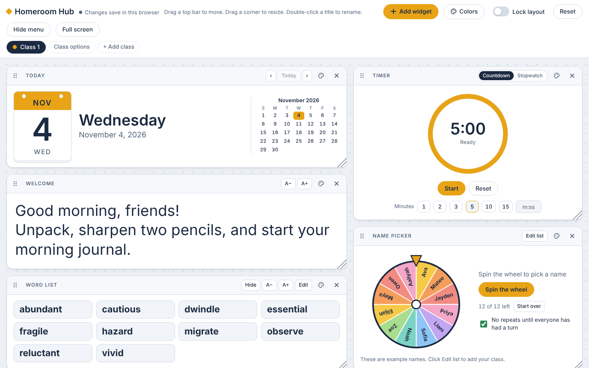

# Homeroom Hub

An interactive classroom display for online 4th–5th grade classes. The teacher shares it on screen during live lessons. It works like a canvas: drag, resize, add and remove widgets to fit each lesson.

**Live demo:** (https://rmenlow92.github.io/Homeroom-Hub/)

## Widgets

**Everyday tools**
- Text boxes for welcome messages and directions
- Vocabulary word list that can be shown or hidden
- Silent countdown timer and stopwatch
- Spinning name wheel, with "no repeats until everyone has had a turn"
- Analog and digital clock, with optional minute numbers for students learning to tell time
- Tear-off calendar with a month view

**Classroom management**
- Fish tank voice level meter: the quieter the class, the more fish swim in
- Don't wake the dragon: a sleeping dragon reacts to the noise level, with a daily wake-up counter
- Rocket to the Moon: a whole-class reward tracker
- Class garden: each point the class earns grows a flower
- Team race: 2–6 animal teams race to the finish line (12 animals to choose from)

## Other features
- A separate tab for each class, each with its own layout, colors and background
- Reader-friendly fonts (Andika, Atkinson Hyperlegible, Lexend, OpenDyslexic, Comic Neue) and an extra letter-spacing option
- Themed backgrounds: autumn, winter, holiday, space, chalkboard, notebook and more, plus custom colors and photos
- Lock layout and hide menu for a clean screen while teaching
- Works in light and dark mode, and respects reduced-motion settings
- No sounds, so it never interrupts a lesson

## How to use
Open `index.html` in any web browser. Everything is in that one file. Changes save automatically in the browser you're using, and nothing is sent anywhere.

## Credits
Designed by Rebecca Walker. Built with Claude, an AI assistant by Anthropic.

Fonts: Andika, Atkinson Hyperlegible, Comic Neue, Fredoka and Lexend load from Google Fonts. OpenDyslexic by Abbie Gonzalez is included in the page under the SIL Open Font License 1.1 (see `FONT-LICENSE-OpenDyslexic.txt`).
